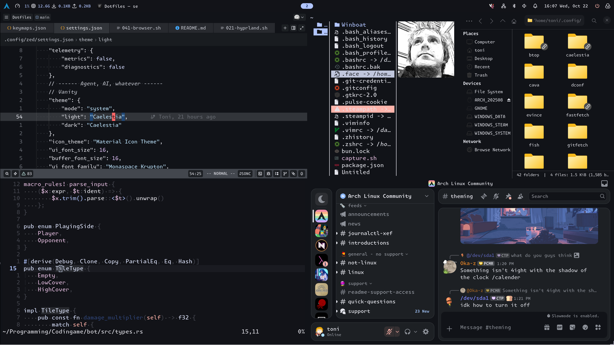
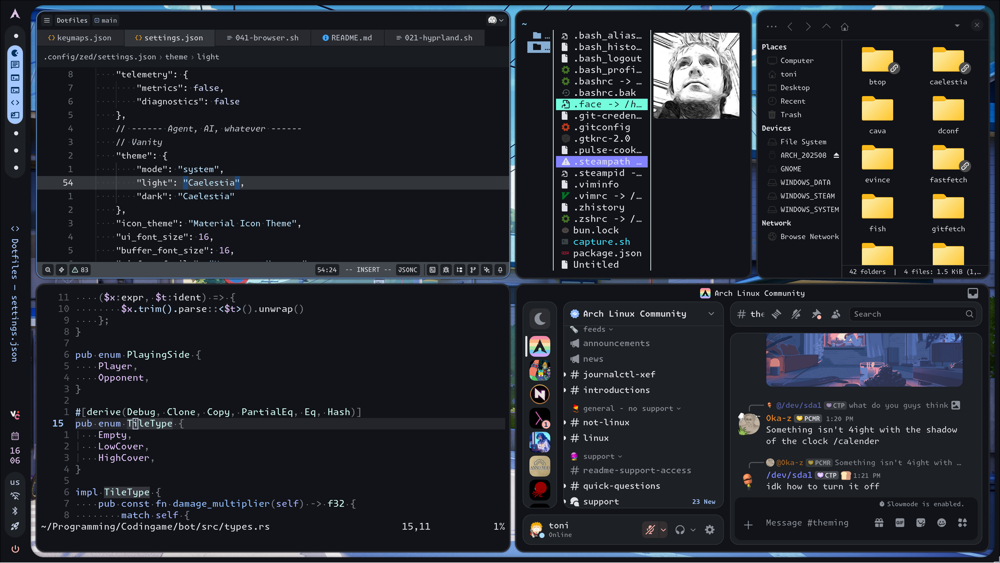
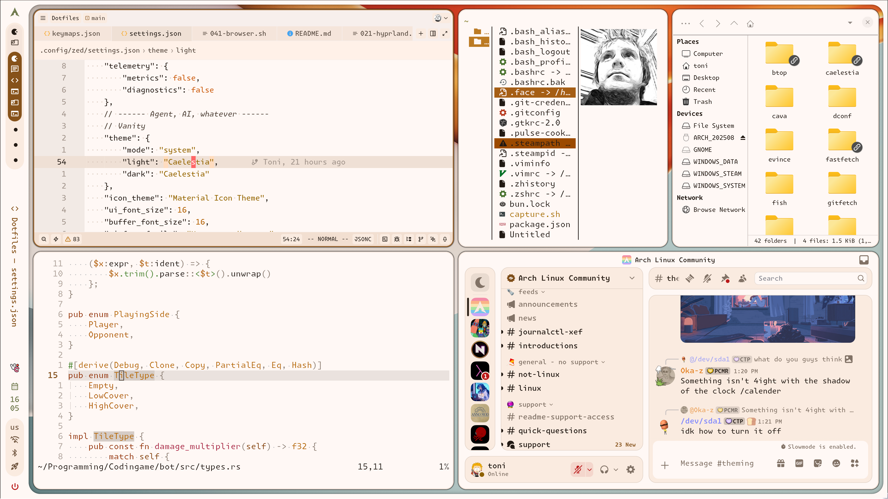
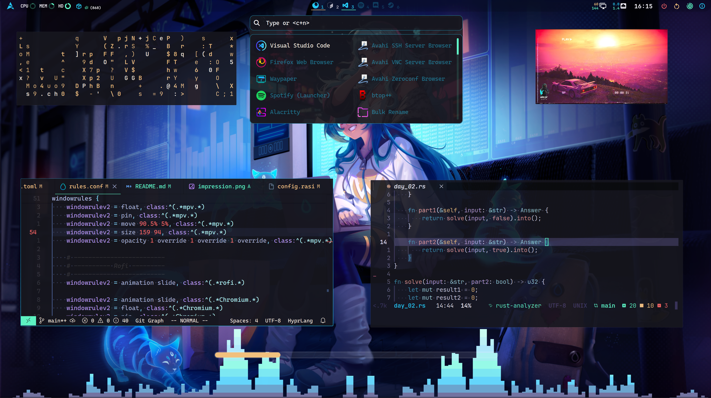
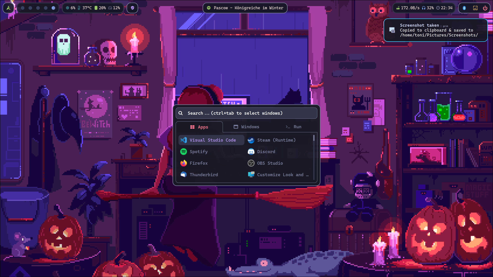

# Dotfiles

Configuration files and assets for an Arch Linux desktop built on
[Hyprland](https://hypr.land/) and [Noctalia](https://github.com/noctalia-dev/noctalia-shell).

> [!NOTE]
> Some key bindings and autostart entries call programs and scripts that are
> not included here, for example [OpenRGB](https://openrgb.org/) or helpers in
> `~/.local/bin`.

## Components

| Area | Software |
| --- | --- |
| Compositor | [Hyprland](https://hypr.land/), configured in its [native Lua API](https://wiki.hypr.land/) |
| Shell (bar, launcher, notifications) | [Noctalia](https://github.com/noctalia-dev/noctalia-shell) v5 |
| Wallpaper | [skwd-wall](https://github.com/liixini/skwd-wall) |
| Greeter / lock screen | [SDDM](https://github.com/sddm/sddm) with [qylock](https://github.com/Darkkal44/qylock) |
| Terminal | [kitty](https://sw.kovidgoyal.net/kitty/), with [btop](https://github.com/aristocratos/btop), [fastfetch](https://github.com/fastfetch-cli/fastfetch) and [yazi](https://github.com/sxyazi/yazi) |
| Editors | [Zed](https://zed.dev/), [Vim](https://www.vim.org/) |
| Browser | [Zen](https://zen-browser.app/) |
| Media | [mpv](https://mpv.io/), [Spotify](https://www.spotify.com/) with [Spicetify](https://spicetify.app/), [Vesktop](https://github.com/Vencord/Vesktop) |
| Boot | [GRUB](https://www.gnu.org/software/grub/) theme and [Plymouth](https://gitlab.freedesktop.org/plymouth/plymouth) splash (`pixel-orbit`) |

## Multiple machines

Hyprland reads `/etc/hostname` on startup and links the matching files
([`conf/hostfiles.lua`](./.config/hypr/conf/hostfiles.lua)). Unknown hosts get a
warning at login.

| Host | Hyprland | Noctalia | skwd-wall |
| :--- | :---: | :---: | :---: |
| **`Z790E`** |  |  |  |
| **`X13GEN5`** |  |  |  |
| *other* |  |  |  |

## Key bindings

The complete list is in [`conf/keybinds.lua`](./.config/hypr/conf/keybinds.lua).
<kbd>SUPER</kbd> + <kbd>BackSpace</kbd> shows it on screen.

| Keys | Action |
| --- | --- |
| <kbd>SUPER</kbd> + <kbd>RETURN</kbd> | Terminal |
| <kbd>SUPER</kbd> + <kbd>R</kbd> | Application launcher |
| <kbd>SUPER</kbd> + <kbd>E</kbd> | File manager |
| <kbd>SUPER</kbd> + <kbd>SHIFT</kbd> + <kbd>C</kbd> | Close window |
| <kbd>SUPER</kbd> + <kbd>F</kbd> | Toggle floating |
| <kbd>SUPER</kbd> + <kbd>M</kbd> | Toggle fullscreen |
| <kbd>SUPER</kbd> + <kbd>H</kbd> <kbd>J</kbd> <kbd>K</kbd> <kbd>L</kbd> | Move focus |
| <kbd>SUPER</kbd> + <kbd>1</kbd>–<kbd>9</kbd> | Switch workspace (add <kbd>SHIFT</kbd> to move the window) |
| <kbd>CTRL</kbd> + <kbd>ALT</kbd> + <kbd>L</kbd> | Lock screen |
| <kbd>SUPER</kbd> + <kbd>SHIFT</kbd> + <kbd>Q</kbd> | Session menu |

## Earlier setups

#### [Noctalia](https://github.com/noctalia-dev/noctalia-shell) v4 · October 2025

  

#### [Caelestia](https://github.com/caelestia-dots/shell) · October 2025

  
  

#### [eww](https://github.com/elkowar/eww) · October 2024

  

#### [eww](https://github.com/elkowar/eww) · July 2024

  

#### [eww](https://github.com/elkowar/eww) · April 2023

  
  

  

